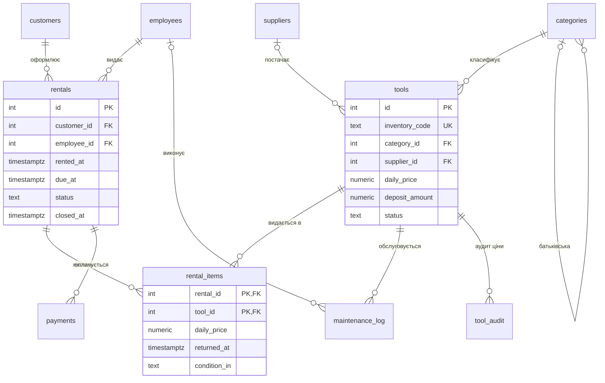

# База даних оренди інструментів та обладнання

Комплект SQL-скриптів до курсової роботи з дисципліни «Бази даних» (КАІ, методичні рекомендації).
Тема: *«Проєктування та реалізація бази даних інформаційної системи оренди інструментів та обладнання»*.

Усі скрипти перевірено на **PostgreSQL 16.15** (psql 16.15). Використано `UNIQUE NULLS NOT DISTINCT`, тому потрібна **версія 15 або новіша** (методичка орієнтується на 18).

## 1. Склад і порядок запуску

| Файл | Призначення | Розділ методички |
|---|---|---|
| `00_run_all.sql` | розгортання одним запуском: 01 → 02 → 03 → 05 | 4.2 |
| `01_schema.sql` | схема `rental`, 10 таблиць, ключі, обмеження, індекси, словник даних | 5.3, 5.4 |
| `02_logic.sql` | 3 функції, 4 процедури, 4 тригери, 3 представлення | 5.5, 5.6 |
| `03_seed.sql` | тестові дані (довідники — `INSERT`, оренди — через процедури) | 5.5 |
| `04_queries.sql` | 19 `SELECT`-запитів, 6 операцій `INSERT/UPDATE/DELETE/UPSERT` | 5.5 |
| `05_security.sql` | 3 ролі, `GRANT`/`REVOKE`, матриця доступу | 5.8 |
| `06_tests.sql` | 23 тести, автоматичний протокол PASS/FAIL | 5.12, дод. Е |
| `07_concurrency.sql` | конкурентні сценарії для двох сеансів (вручну) | 5.7 |
| `07_concurrency_demo.sh` | те саме автоматично: два процеси `psql` | 5.7 |
| `08_performance.sql` | 100 000 оренд, `EXPLAIN (ANALYZE, BUFFERS)` до/після індексів | 5.9 |
| `09_verify.sql`, `09_backup_restore.sh` | `pg_dump` → відновлення в окрему базу → порівняння | 5.10 |

```bash
createdb rental_db
psql -d rental_db -v ON_ERROR_STOP=1 -f 00_run_all.sql   # розгортання
psql -d rental_db -f 04_queries.sql                      # запити та операції зміни
psql -d rental_db -v ON_ERROR_STOP=1 -f 06_tests.sql     # тести (після прогону БД не змінюється)
bash 07_concurrency_demo.sh                              # конкурентний доступ
psql -d rental_db -f 08_performance.sql                  # продуктивність (схема perf)
bash 09_backup_restore.sh                                # резервна копія й перевірка відновлення
```

**Вимоги до середовища.** Потрібен клієнт `psql` (скрипти використовують `\ir`, `\gset`, `\pset`). Для `09_backup_restore.sh` користувач має право `CREATEDB` (або створіть базу `rental_restore` заздалегідь). Пароль не зберігається в скриптах: використовуйте `~/.pgpass` чи змінну `PGPASSWORD`. Ролі `rental_*` створюються в кластері, а не в базі, тому переживають `DROP DATABASE`. Скрипт `05_security.sql` повторно запускний, а `01_schema.sql` — ні (потрібна порожня база або `DROP SCHEMA rental CASCADE`).

## 2. Відповідність орієнтирам таблиці 5.1

| Елемент | Орієнтир | Реалізовано |
|---|---|---|
| Таблиці | 8–12 | 10 |
| Правила | від 8 | 15 (BR01–BR15, див. п. 3) |
| Запити SELECT | від 15 | 19 (JOIN, LEFT JOIN, GROUP BY/HAVING/FILTER, EXISTS/NOT EXISTS, підзапити, `DISTINCT ON`, `RANK`, `LAG`, накопичувальна й ковзна сума, рекурсивний CTE) |
| Операції зміни | від 4 | 6: `INSERT … RETURNING`, 2×`UPDATE`, `UPSERT` (`DO UPDATE` і `DO NOTHING`), `DELETE … RETURNING` |
| Представлення | від 2 | 3 |
| Функції та процедури | від 3 разом | 3 функції + 4 процедури (є й функція, і процедура) |
| Тригери | від 2 | 4: `BEFORE` (перехід стану, блокування клієнта) та `AFTER` (аудит, синхронізація стану) |
| Ролі | від 2 | 3 (оператор, менеджер, аналітик) |
| Тестові сценарії | від 10 | 23 тести в `06_tests.sql`: позитивні, негативні, граничні, права доступу, відкат |
| Додатково | конкурентність, 2 плани, відновлення | `07_*` (2 сценарії), `08` (3 запити), `09` (повний цикл) |

## 3. Трасування вимог (таблиця 5.2)

| Код | Вимога | Реалізація | Перевірка |
|---|---|---|---|
| BR01 | Інвентарний код інструмента унікальний | `UNIQUE` | T02 |
| BR02 | Ціна оренди додатна | `CHECK tools_daily_price_pos` | T03 |
| BR03 | Строк повернення пізніше за початок оренди | `CHECK rentals_due_after_start` | T04 |
| BR04 | Інструмент одночасно лише в одній активній оренді | частковий `UNIQUE (tool_id) WHERE returned_at IS NULL` | T10, `07_*` |
| BR05 | Історія оренд не втрачається | `FOREIGN KEY … ON DELETE RESTRICT` | T05 |
| BR06 | Телефон клієнта коректний і унікальний | `CHECK` (регулярний вираз) + `UNIQUE` | T06 |
| BR07 | Знижка клієнта 0–30% | `CHECK customers_discount_range` | T07 |
| BR08 | Оренда не довша за 60 діб | `CHECK rentals_max_duration` | T08, T09 |
| BR09 | Допустимі переходи стану інструмента | тригер T1 (`BEFORE UPDATE OF status`) | T11 |
| BR10 | Заблокований клієнт не може орендувати | тригер T3 (`BEFORE INSERT ON rentals`) | T12 |
| BR11 | Зміни ціни фіксуються в аудиті | тригер T2 (`AFTER UPDATE OF daily_price`) | T19, T20 |
| BR12 | Повернення не раніше початку оренди | процедура `return_tool` | T14 |
| BR13 | Видача оренди — атомарна операція | процедура `open_rental` (одна транзакція) | T13, T15 |
| BR14 | Пошкоджений інструмент іде в ремонт | тригер T4 (`AFTER … ON rental_items`) | T17 |
| BR15 | Не більше одного відкритого ремонту інструмента | частковий `UNIQUE … WHERE finished_at IS NULL` | T18 |
| FR01 | Перелік активних та прострочених оренд | `v_active_rentals`, запити Q01, Q02 | Q01, Q02 |
| FR02 | Дохід за місяцями без персональних даних | `v_monthly_revenue` | Q14 |
| FR03 | Розрахунок вартості та штрафу | функції `rental_amount`, `late_fee`, `billed_days` | T15, T16, Q18 |
| NFR01 | Аналітик лише читає, без ПІБ і телефонів | колонкові `GRANT SELECT` | T21 |
| NFR02 | Оператор змінює дані лише через процедури | `SECURITY DEFINER` + відсутність прямих прав | T01, T22 |
| NFR03 | Історія клієнта (QA) і список прострочених (QB) виконуються менш ніж за 10 мс на 100 000 оренд | індекси, `08_performance.sql` | `EXPLAIN (ANALYZE)` |
| NFR04 | Дані відновлюються з копії | `09_backup_restore.sh` | diff виводів |

## 4. ER-діаграма



Зв'язок N:M «оренда ↔ інструмент» реалізовано таблицею `rental_items`; її власні атрибути (ціна на момент оренди, дата й стан повернення) описують саме зв'язок.

## 5. Нормалізація (для розділу 2.2 записки)

Модель відповідає 3НФ: довідники (`suppliers`, `categories`, `employees`) винесено окремо, і кожен факт зберігається в одному місці (назва категорії, контакти постачальника). Складений ключ `rental_items (rental_id, tool_id)` не має неключових атрибутів, що залежать лише від частини ключа (2НФ). Транзитивних залежностей немає: ПІБ і телефон клієнта не дублюються в `rentals`.

**Свідома денормалізація.** `rental_items.daily_price` копіює `tools.daily_price` на момент видачі. Це потрібно для коректної історії: зміна прайсу не повинна перераховувати старі оренди. Узгодженість забезпечено тим, що значення записує лише процедура `open_rental`, а аудит зміни ціни веде тригер T2.

## 6. Порівняння з нереляційною моделлю (розділ 5.11)

Для цього процесу доречна одна альтернатива — **Redis** як кеш «поточної доступності» каталогу. Основним сховищем лишається PostgreSQL: оренди, платежі й історія потребують транзакцій та обмежень цілісності (часткові унікальні індекси, зовнішні ключі). У записці слід обґрунтувати: що вважається основними даними (PostgreSQL), як кеш оновлюється (після `COMMIT` процедур `open_rental`/`return_tool`), термін життя ключів і поведінку при втраті кешу (повне перечитування з БД). **MongoDB** виправдана лише для каталогу з довільними характеристиками інструментів; у цій моделі атрибути однорідні, тому переваги немає.

## 7. Припущення та обмеження рішення

Їх варто чесно описати у висновках записки.

- **Поточна дата сценаріїв — 2026-11-11.** Запити з `now()` (Q02, Q18, Q19, представлення `v_active_rentals`) залежать від дати запуску: набір рядків той самий, змінюється кількість діб прострочення.
- **Час.** Усі моменти — `timestamptz`; у виводі вони показуються в часовому поясі сеансу. Місяці й тижні у звітах рахуються за `Europe/Kyiv`.
- **Тарифікація.** Кожна розпочата доба оплачується повністю (мінімум 1 доба), штраф — 50% ціни за кожну розпочату добу прострочення (параметр `p_penalty_rate`). Це припущення моделі, а не вимога методички.
- **Застава.** При поверненні сума повернення = внесена застава мінус застави пошкоджених інструментів (беруться з поточного `tools.deposit_amount`; історичні застави потребували б окремого знімка, як для ціни).
- **Історичні ціни та пороги** зберігаються лише для позицій оренди (`rental_items.daily_price`), а не як окрема модель періодів дії.
- **`SECURITY DEFINER`.** Процедури й тригерні функції, що змінюють кілька таблиць, виконуються з правами власника з фіксованим `search_path`. У журнал аудиту пишеться `session_user`, бо всередині такої функції `current_user` — це власник.
- **Пропуски в нумерації.** `IDENTITY` використовує послідовності: після помилок і відкатів у `id` є пропуски, тому тести не вимагають неперервної нумерації.
- **RLS** не застосовано: роботу з правами побудовано через `GRANT`, колонкові права й процедури. Для розгортання в Supabase політики RLS слід перевіряти окремо для ролі, під якою працює клієнт.
